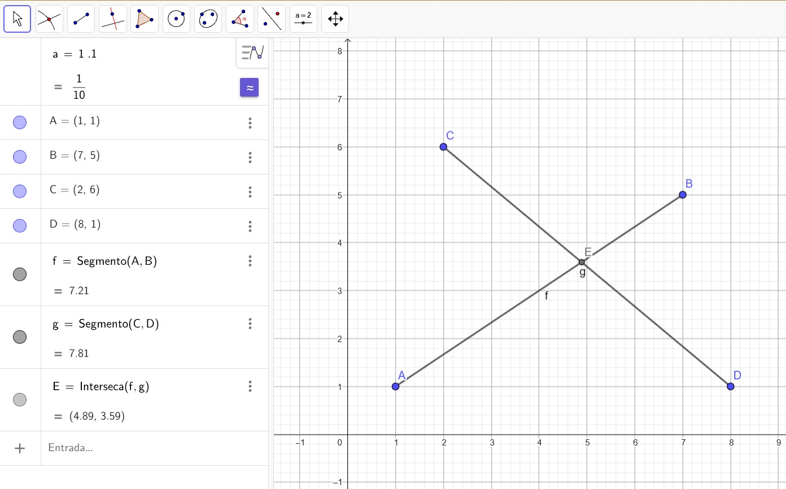
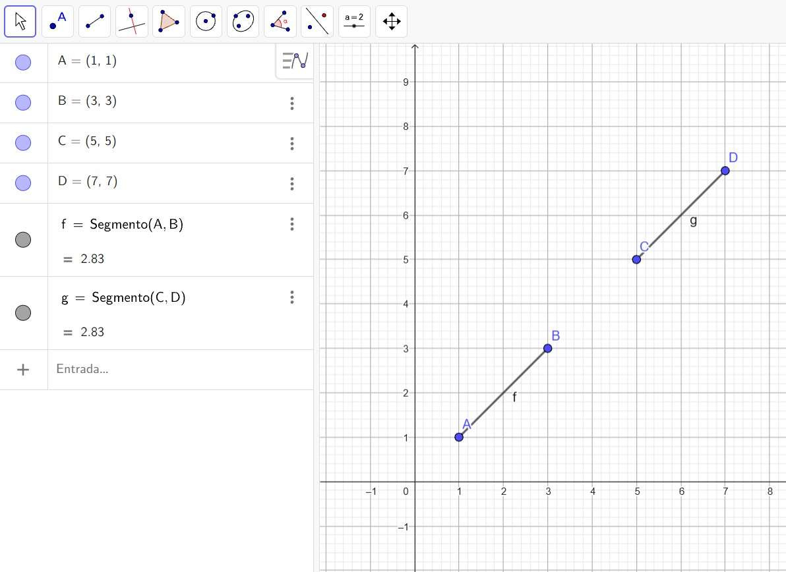
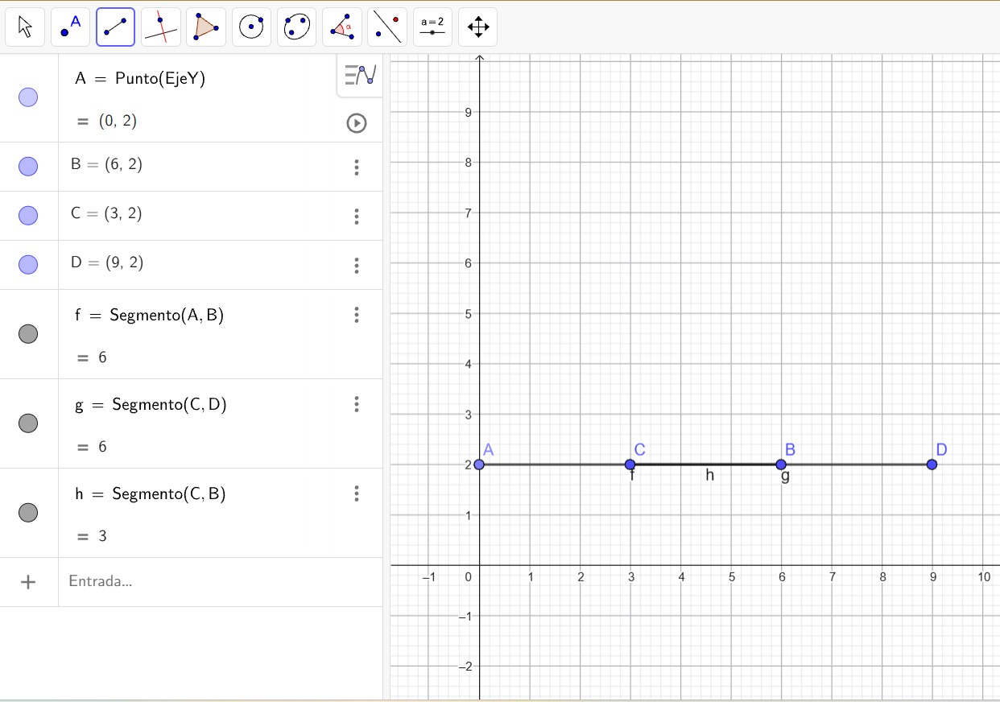

# Taller – 
## Ejercicio 2: ¿Se cruzan las rutas de los autos?


**Situación:** Una empresa de logistica utiliza autos transportadores autónomos, el sistema debe verificar si dos rutas se cruzan para ese caso necesitamos analizar segmentos: 

---

## Idea general (explicada fácil)

Para saber si dos rutas se cruzan hacemos una pregunta simple:
**"Si camino de un punto a otro y luego miro un tercer punto, ¿tengo que girar a la izquierda, a la derecha, o sigo derecho?"**

A eso se le llama **orientación**. Se calcula así, con los puntos `P`, `Q`, `R`:

```
valor = (Qx - Px) · (Ry - Py)  -  (Qy - Py) · (Rx - Px)
```

- Si `valor > 0` → gira a la **izquierda** (lo anotamos como `+1`)
- Si `valor < 0` → gira a la **derecha** (lo anotamos como `-1`)
- Si `valor = 0` → los tres puntos están **en línea recta** (lo anotamos como `0`)

Para dos segmentos **A-B** y **C-D** calculamos 4 orientaciones:

| Nombre | Pregunta que responde                      |
|--------|--------------------------------------------|
| **o1** | Mirando de A a B, ¿hacia qué lado queda C? |
| **o2** | Mirando de A a B, ¿hacia qué lado queda D? |
| **o3** | Mirando de C a D, ¿hacia qué lado queda A? |
| **o4** | Mirando de C a D, ¿hacia qué lado queda B? |

**Regla:** si `o1 ≠ o2` **y** `o3 ≠ o4`, los segmentos se cruzan (cada uno deja los extremos del otro a lados opuestos). Si hay ceros (puntos en línea recta), hay que revisar si un punto cae dentro del otro segmento (contacto o superposición).

---

## Caso 1

**Puntos:** A(1,1), B(7,5), C(2,6), D(8,1)

### 1. Gráfica



### 2. Las 4 orientaciones

| Orientación        | Cuenta                       | Resultado | Significado                   |
|--------------------|------------------------------|-----------|-------------------------------|
| o1 = orient(A,B,C) | 6·5 − 4·1 = **26**           | +1        | C queda a la izquierda de A→B |
| o2 = orient(A,B,D) | 6·0 − 4·7 = **−28**          | −1        | D queda a la derecha de A→B   |
| o3 = orient(C,D,A) | 6·(−5) − (−5)·(−1) = **−35** | −1        | A queda a la derecha de C→D   |
| o4 = orient(C,D,B) | 6·(−1) − (−5)·5 = **19**     | +1        | B queda a la izquierda de C→D |

### 3. ¿Hay intersección?

- o1 (+1) ≠ o2 (−1) → C y D están a lados distintos de A-B ✔
- o3 (−1) ≠ o4 (+1) → A y B están a lados distintos de C-D ✔

**Sí se cruzan.** El cruce ocurre aproximadamente en el punto **(4.89, 3.59)** .

---

## Caso 2

**Puntos:** A(1,1), B(3,3), C(5,5), D(7,7)

### 1. Gráfica



### 2. Las 4 orientaciones

Los cuatro puntos están sobre la misma línea (y = x), así que no hay giros:

| Orientación        | Resultado |
|--------------------|-----------|
| o1 = orient(A,B,C) | **0**     |
| o2 = orient(A,B,D) | **0**     |
| o3 = orient(C,D,A) | **0**     |
| o4 = orient(C,D,B) | **0**     |

### 3. ¿Hay intersección?

Todo da 0, entonces hay que ver si los segmentos se "montan" uno sobre otro:

- A-B ocupa de x = 1 hasta x = 3
- C-D ocupa de x = 5 hasta x = 7
- Entre el 3 y el 5 hay un espacio vacío, no se tocan.

**No hay intersección.** Los dos autos van por la misma línea, pero uno va "detrás" del otro sin encontrarse generalmente separados.

---

## Caso 3

**Puntos:** A(0,2), B(6,2), C(3,2), D(9,2)

### 1. Gráfica




### 2. Las 4 orientaciones

Todos los puntos están en la línea horizontal y = 2:

| Orientación        | Resultado |
|--------------------|-----------|
| o1 = orient(A,B,C) | **0**     |
| o2 = orient(A,B,D) | **0**     |
| o3 = orient(C,D,A) | **0**     |
| o4 = orient(C,D,B) | **0**     |

### 3. ¿Hay intersección?

- A-B ocupa de x = 0 hasta x = 6
- C-D ocupa de x = 3 hasta x = 9
- Se montan entre x = 3 y x = 6.

**Sí hay intersección, por superposición.** Comparten todo el tramo de (3,2) a (6,2) (lo que se puede tomar como el segmento de C  a B). Es el caso más peligroso: los dos autos irían por el mismo camino al mismo tiempo.

---

## 5. ¿Por qué detectar la intersección es O(1)?

**O(1) significa que el trabajo es siempre el mismo, sin importar qué tan grandes sean los números o qué tan largas sean las rutas.**

Pensemos en una receta de cocina con pasos fijos. Para revisar dos segmentos, el algoritmo siempre hace exactamente lo mismo:

1. Calcula **4 orientaciones** (4 cuentas pequeñas de restas y multiplicaciones).
2. Compara esos 4 resultados entre sí.
3. Si hay ceros, hace como máximo **4 comparaciones** más para ver si un punto cae dentro de un segmento.

Eso es todo. No hay ciclos que se repitan, ni listas que recorrer, ni nada que crezca con el tamaño de la ruta.

Un ejemplo: una ruta de 10 metros y otra de 10,000 kilómetros se revisan con **las mismas cuentas**. Solo cambian los números dentro de las operaciones, no la cantidad de operaciones.

Como siempre son los mismos pocos pasos, el tiempo es **constante**, y eso es lo que significa O(1).

## Ejercicio 5 
## El problema

Dos equipos proponen una forma distinta de resolver la triangulación. Hay que decidir cuál conviene usar.

| Algoritmo | Cómo es | Cuánto trabajo hace (T) |
|---|---|---|
| **A** | Sencillo, pero repite muchas verificaciones | T_A(n) = n³ |
| **B** | Mucho más eficiente | T_B(n) = n² |

Aquí **n** es el tamaño del problema, podria decirse como la cantidad de puntos y **T(n)** es la cantidad de pasos que hace el algoritmo.

---

## Cálculo de T_A(n) y T_B(n)

**Algoritmo A:** se multiplica n × n × n.
**Algoritmo B:** se multiplica n × n.

### Para n = 10
- T_A(10) = 10³ = 10 × 10 × 10 = **1.000**
- T_B(10) = 10² = 10 × 10 = **100**

### Para n = 100
- T_A(100) = 100³ = **1.000.000** (un millón)
- T_B(100) = 100² = **10.000**

### Para n = 1.000
- T_A(1.000) = 1.000³ = **1.000.000.000** (mil millones)
- T_B(1.000) = 1.000² = **1.000.000** (un millón)

---

## Tabla comparativa

| n     | T_A(n) = n³   | T_B(n) = n² | Razón T_A / T_B                       | Big O de A | Big O de B |
|-------|---------------|-------------|---------------------------------------|------------|------------|
| 10    | 1.000         | 100         | 1.000 / 100 = **10**                  | O(n³)      | O(n²)      |
| 100   | 1.000.000     | 10.000      | 1.000.000 / 10.000 = **100**          | O(n³)      | O(n²)      |
| 1.000 | 1.000.000.000 | 1.000.000   | 1.000.000.000 / 1.000.000 = **1.000** | O(n³)      | O(n²)      |

### ¿Qué significa Big O?

Big O es una forma de decir **cómo crece el trabajo cuando el problema se hace más grande**:

- **O(n²)** (algoritmo B): si el problema se hace 10 veces más grande, el trabajo se hace 100 veces más grande.
- **O(n³)** (algoritmo A): si el problema se hace 10 veces más grande, el trabajo se hace 1.000 veces más grande.

---

## La razón T_A(n) / T_B(n)

La razón nos dice **"cuántas veces más trabajo hace A que B"**.

Mirando la tabla, se nota un patrón: la razón es **igual a n**.

```
T_A / T_B = n³ / n² = n
```

Es decir:
- Con n = 10, A hace **10 veces** más trabajo que B.
- Con n = 100, A hace **100 veces** más trabajo.
- Con n = 1.000, A hace **1.000 veces** más trabajo.

**La diferencia no se queda quieta: entre más grande es el problema, peor se pone A frente a B.**

---
##  ¿qué algoritmo conviene?

**Conviene el algoritmo B (n²).**

Razones:

1. **Hace menos trabajo siempre** (para n > 1), y la ventaja crece con el tamaño del problema.
2. **Escala mejor:** si en el futuro la empresa trabaja con más datos, B seguirá siendo manejable y A se volverá demasiado lento.
3. **La razón es igual a n:** con 1.000 elementos, B es 1.000 veces más rápido.

El algoritmo A solo tendría sentido si el problema fuera siempre muy pequeño (por ejemplo, 10 elementos) y se quisiera algo muy fácil de programar. Pero para un sistema real de logística, donde los datos pueden crecer, **B es la mejor elección**.
